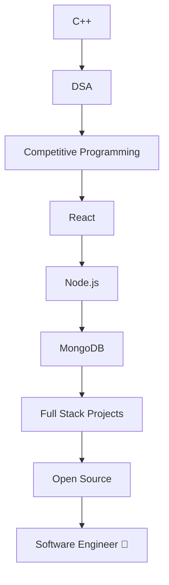

# 🚀 Premium GitHub README (`README.md`)

````markdown
<div align="center">


<h1>Hi 👋, I'm <span style="color:#00F7FF;">Vansh Garg</span></h1>


</div>

---

# 💫 About Me

🎓 B.Tech CSE Student @ **ABES Engineering College**

💻 Passionate about **DSA, Full Stack Development & Open Source**

🚀 Currently Learning:
- Advanced DSA
- React.js
- Node.js
- MongoDB

---

# 💻 Tech Stack

<p align="center">


</p>

---

# 📊 GitHub Stats

<p align="center">


</p>

---

# 🔥 GitHub Streak

<p align="center">


</p>

---

# 📈 Contribution Graph

<p align="center">


</p>

---

# 🏆 GitHub Trophies

<p align="center">


</p>

---

# 📊 Skill Progress

```text
C++          ████████████████████ 95%

DSA          ██████████████████   90%

HTML/CSS     █████████████████    88%

JavaScript   ████████████████     82%

React.js     ██████████████       78%

Node.js      ████████████         72%

MongoDB      ██████████           68%
````

---

# 🚀 Developer Roadmap



---

# 🌐 Coding Profiles

<p align="center">

<a href="https://leetcode.com/u/vanshgarg355/">

</a>

<a href="https://www.codechef.com/users/vanshgarg">

</a>

<a href="https://github.com/vanshgarg355-boop">

</a>

</p>

---

# 📫 Connect With Me

<p align="center">

<a href="https://linkedin.com/in/vansh-garg-38b007384">

</a>

</p>

---

# 💡 Random Dev Quote

<p align="center">


</p>

---

# 🐍 Snake Contribution

> Enable GitHub Actions to generate:

```text
https://raw.githubusercontent.com/vanshgarg355-boop/vanshgarg355-boop/output/github-contribution-grid-snake-dark.svg
```

Then use:

```html
<p align="center">

</p>
```

---

# ⚡ Fun Code

```cpp
class Vansh
{
public:

    void Life()
    {
        while(true)
        {
            Learn();
            Code();
            Build();
            Repeat();
        }
    }
};
```

---

<div align="center">

## ⭐ Thanks for visiting my profile ⭐


</div>
```
